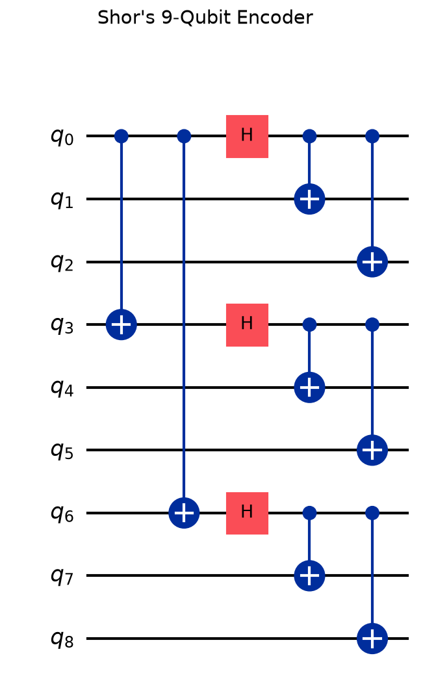
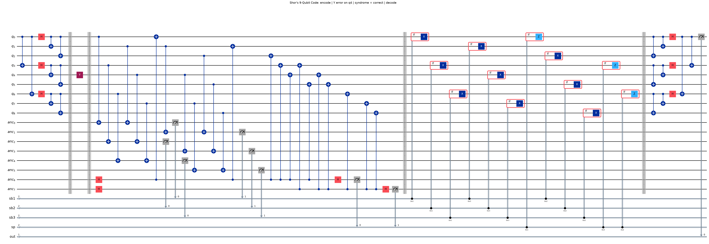

# ShorShield 🛡️

**A Qiskit simulator that protects one qubit with Shor's 9-qubit error-correcting code, then proves it by trying every possible single-qubit error.**

ShorShield encodes 1 logical qubit into 9 physical qubits. It then injects a bit-flip (X), phase-flip (Z) or combined (Y) error on any of the 9 qubits, measures the error **syndrome** with 8 ancilla qubits, applies the matching correction and decodes. The result is an **Error Location vs. Syndrome vs. Recovery** table covering all 28 cases (27 errors plus a no-error baseline) on 4 different input states.

> Project topic: **Topic 23 — Shor's 9-Qubit Code** (Quantum Computing course project)

---

## Why this project matters

Real qubits are fragile. Noise from heat, stray fields or imperfect gates can:

- **flip** a qubit (|0⟩ ↔ |1⟩), which is an **X error**
- **flip its phase** (|+⟩ ↔ |−⟩), which is a **Z error**
- or do **both**, which is a **Y error**

You can't just copy a qubit to back it up (the *no-cloning theorem*), and measuring it directly destroys the superposition. **Quantum error correction** gets around both problems: it spreads the information across several qubits and measures only *parity checks* (the syndrome). These checks reveal **where** the error is without revealing **what** the stored state is.

Shor's 9-qubit code (1995) was the **first** code able to correct an arbitrary single-qubit error. It is the conceptual ancestor of the surface codes used in today's quantum hardware. ShorShield lets you watch it work step by step.

**Use it to:**
- learn and demonstrate how quantum error correction works
- see exactly which syndrome each error produces
- produce the result table and circuit diagrams for a report or presentation
- experiment by changing the error, the input state or the shot count

---

## How the code works

```
|ψ⟩ ──► ENCODE ──► ERROR ──► SYNDROME ──► CORRECT ──► DECODE ──► |ψ⟩ restored
        (9 qubits)  (X/Y/Z)   (8 ancillas)  (if-tests)
```

**1. Encoding: two layers of repetition**

| Layer | Protects against | How |
|---|---|---|
| Outer (phase-flip code) | Z errors | `CX` from q0 → q3, q6, then `H` on q0, q3, q6 |
| Inner (bit-flip code) | X errors | inside each block, `CX` from the leader to the other two |

The logical states become:

```
|0_L⟩ = (|000⟩ + |111⟩)(|000⟩ + |111⟩)(|000⟩ + |111⟩) / 2√2
|1_L⟩ = (|000⟩ − |111⟩)(|000⟩ − |111⟩)(|000⟩ − |111⟩) / 2√2
```

The 9 qubits form 3 blocks: **B1 = q0–q2, B2 = q3–q5, B3 = q6–q8**.

**2. Syndrome extraction (8 ancillas)**

- **Bit-flip checks (6 ancillas):** each block measures `Z₀Z₁` and `Z₁Z₂` parity. The 2-bit result points at the flipped qubit:

  | Block syndrome | Meaning |
  |---|---|
  | `00` | no bit flip |
  | `10` | first qubit flipped |
  | `11` | middle qubit flipped |
  | `01` | last qubit flipped |

- **Phase-flip checks (2 ancillas):** measure `X⁶` parity on blocks 1+2 and on blocks 2+3. The result points at the block whose sign flipped: `10` → B1, `11` → B2, `01` → B3.

**3. Correction:** classically controlled `X`/`Z` gates (`if_test`) apply the fix the syndrome points to. A Y error triggers both checks, so it gets both an X fix and a Z fix.

**4. Verification:** the circuit decodes, undoes the input-state preparation and measures. A perfect recovery always reads `0`.

---

## Results

All **112 runs** (28 error cases × 4 input states: `|0⟩`, `|1⟩`, `|+⟩` and an arbitrary state) recover **100%**. Excerpt from `results_table.csv`:

| Error | Qubit | Block | Bit-flip syndrome (B1 B2 B3) | Phase syndrome | Correction applied | Recovered |
|---|---|---|---|---|---|---|
| None | – | – | `00 00 00` | `00` | none | 100% |
| X | q0 | 1 | `10 00 00` | `00` | X on q0 | 100% |
| X | q4 | 2 | `00 11 00` | `00` | X on q4 | 100% |
| X | q8 | 3 | `00 00 01` | `00` | X on q8 | 100% |
| Z | q1 | 1 | `00 00 00` | `10` | Z on block 1 | 100% |
| Z | q4 | 2 | `00 00 00` | `11` | Z on block 2 | 100% |
| Z | q7 | 3 | `00 00 00` | `01` | Z on block 3 | 100% |
| Y | q2 | 1 | `01 00 00` | `10` | X on q2, Z on block 1 | 100% |
| Y | q4 | 2 | `00 11 00` | `11` | X on q4, Z on block 2 | 100% |
| Y | q6 | 3 | `00 00 10` | `01` | X on q6, Z on block 3 | 100% |

What the table shows:
- Every **X error** produces its own bit-flip syndrome, so the exact qubit is found.
- A **Z error** is identified only down to its **block**. That is enough, because a Z on any qubit of a block has the same effect on the encoded state.
- A **Y error** (= iXZ) lights up both kinds of checks and is fixed by both corrections.

### Circuit diagrams

**Encoder** (`circuit_encoder.png`)



**Full circuit**: encode → Y error on q4 → syndrome → correct → decode (`circuit_full.png`)



---

## Run it on your own machine

**Requirements:** Python **3.10 or newer** (tested on 3.11.9) and Git.

### 1. Clone

```bash
git clone https://github.com/aswinsamuel-codes/ShorShield.git
cd ShorShield
```

### 2. Create a virtual environment (recommended)

Windows (PowerShell):
```bash
python -m venv .venv
.venv\Scripts\Activate.ps1
```

macOS / Linux:
```bash
python3 -m venv .venv
source .venv/bin/activate
```

### 3. Install dependencies

```bash
pip install -r requirements.txt
```

### 4. Run

```bash
python shor_9qubit_code.py
```

It takes **about 1 minute**. You should see the full table printed, ending with:

```
All single-qubit errors corrected for every input state: True
Saved table   -> .../results_table.csv
Saved diagram -> .../circuit_full.png
Saved diagram -> .../circuit_encoder.png
```

The three output files are regenerated next to the script on every run.

---

## Customise it

Everything is in `shor_9qubit_code.py`:

| Want to… | Change |
|---|---|
| Use more or fewer shots | `SHOTS = 256` |
| Protect a different state | add an entry to both `INPUT_STATES` and `UNPREPARE` (the second must undo the first) |
| Draw a different error in the diagram | `build_shor_circuit("Y", 4, "|0>")` in `main()` |
| Build a single circuit yourself | `build_shor_circuit(error_type="X", error_qubit=7, state="|+>")` |

---

## Project structure

```
├── shor_9qubit_code.py   # encoder, error injection, syndrome + correction, decoder, test harness
├── requirements.txt      # Python dependencies
├── results_table.csv     # generated: Error vs Syndrome vs Recovery table
├── circuit_full.png      # generated: full circuit diagram
└── circuit_encoder.png   # generated: encoder diagram
```

---

## Troubleshooting

| Problem | Fix |
|---|---|
| `ModuleNotFoundError: No module named 'qiskit'` | Activate the virtual environment, then rerun `pip install -r requirements.txt` |
| `ImportError: DLL load failed ... Application Control policy has blocked this file` (Windows) | Windows Smart App Control is blocking Qiskit's compiled library. Try a Python environment that already runs Qiskit, or install with your regular Python instead of a fresh venv |
| Python crashes with `access violation` / `Segmentation fault` (Windows) | The script already imports Qiskit Aer before matplotlib and runs single-threaded to avoid this. Make sure you haven't reordered the imports at the top |
| `MissingOptionalLibraryError: pylatexenc` | `pip install pylatexenc` (needed for circuit drawings) |
| Slow run | It uses the matrix-product-state simulator, which is about 20× faster than statevector here. Lower `SHOTS` if needed |

---

## Tech stack

[Qiskit](https://www.ibm.com/quantum/qiskit) 2.6 · Qiskit Aer 0.18 · pandas · matplotlib

## References

- P. W. Shor, *Scheme for reducing decoherence in quantum computer memory*, Phys. Rev. A 52, R2493 (1995)
- M. A. Nielsen & I. L. Chuang, *Quantum Computation and Quantum Information*, §10.2
